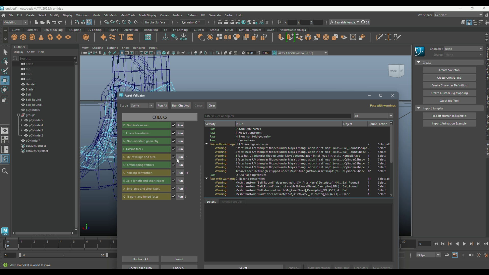

# Maya Asset Validator

[](https://buymeacoffee.com/saurabhkundalwal)

A Python tool for checking static polygon assets in Autodesk Maya before hand-off. It reports problems in a separate window, shows the affected objects or components, and lets you select them in Maya. Running checks does not edit the mesh.

The release contains the installer, Maya module file, shelf helper, and the Python package. Maya supplies Python, Qt, and the Maya API; there are no pip dependencies.

## Demo

[](media/demo_sword_import.mp4)

[Watch the 2:56 demo video](media/demo_sword_import.mp4) (9.3 MB). It shows the sword asset being checked in Maya and the results in the validator window.

## Compatibility

| Maya | UI binding |
| --- | --- |
| 2024 | PySide2 |
| 2025–2026 | PySide6 |

The window and checks have been exercised in Maya 2024, 2025, and 2026. The tool is intended for static polygon meshes; Unreal integration is outside this package.

## Install

1. Download this repository as a ZIP and extract it. Keep `install_asset_validator.py` inside the extracted folder with `scripts` beside it.
2. Open Maya and drag `install_asset_validator.py` into the viewport.
3. Choose **Install**. The installer copies the runtime files to that Maya version's user modules folder and adds a **Validate** button to the `ValidationToolMaya` shelf.

Drag the installer into each Maya version you want to use. To update, drag it in again and choose **Reinstall**. To remove the installed copy, choose **Uninstall** from the same dialog, then restart Maya.

You can also open the tool from Maya's Python Script Editor:

```python
from asset_validator.launcher import launch
launch()
```

### Manual install

Keep this folder together, add the folder containing `Validation_Tool_Maya.mod` to `MAYA_MODULE_PATH`, and restart Maya. Then run this once in Maya's Python Script Editor to add the shelf button:

```python
from asset_validator.shelf import install_shelf
install_shelf()
```

## Use

Choose **Selection**, **Hierarchy**, or **Scene**, then click **Run All**. An empty Selection checks nothing. **Run Checked** uses only the ticked checks; each check also has its own **Run** button. Click a result for details or **Select** to locate it in Maya. Edit the scene and run the checks again when the report says **Stale**.

| Code | Check | Finds |
| --- | --- | --- |
| D | Duplicate names | Reused object or shape names |
| T | Freeze transforms | Non-default transforms or offsets, including parent transforms |
| N | Non-manifold geometry | Problem edges and vertices |
| L | Lamina faces | Faces sharing the same edges and position |
| U | UV coverage and area | Missing, collapsed, or flipped UVs in `map1` |
| O | Overlapping vertices | Separate vertices close enough to need review |
| C | Naming convention | Names outside `SM_AssetName[_Descriptor]_NN` and mismatched shape names |
| E | Zero-length and short edges | Collapsed or very short edges |
| A | Zero-area and sliver faces | Collapsed or very thin faces |
| G | N-gons and holed faces | Faces with more than four corners or holes |

The validator does not automatically repair topology or weld overlapping vertices. The overlap result can be marked **Intentional** or **Error** without changing the mesh. Those marks are kept beside a saved scene in a `.validator-intent.json` file. **Rename** previews a duplicate-name change before applying it, and **New Identity** gives an eligible imported copy a new Maya ID. These two actions are undoable.

Distance and area checks use centimetres, regardless of the scene's display unit. Overlap, edge-length, and face-area measurements use the mesh before its transform is applied, so review the transform result as well. The UV check uses `map1`.

## Package layout

```text
Validation_Tool_Maya.mod          Maya module definition for manual installs
install_asset_validator.py        Drag-and-drop install, reinstall, and uninstall
shelf/install_shelf.py            Optional shelf setup for manual installs
scripts/asset_validator/          Runtime Python package
  checks/                        Ten validation rules
  core/                          Check runner and report state
  data_models/                   Results and settings
  maya_adapter/                  Mesh and scope collection
  ui/                            Window and result display
  fixes/                         Guarded rename and identity actions
  intent/                        Overlap decisions and scene sidecar
```

## License

MIT. See [LICENSE](LICENSE).

## Support

If this tool helps your work, you can [buy me a coffee](https://buymeacoffee.com/saurabhkundalwal). Support is optional; the tool remains free and open source.
